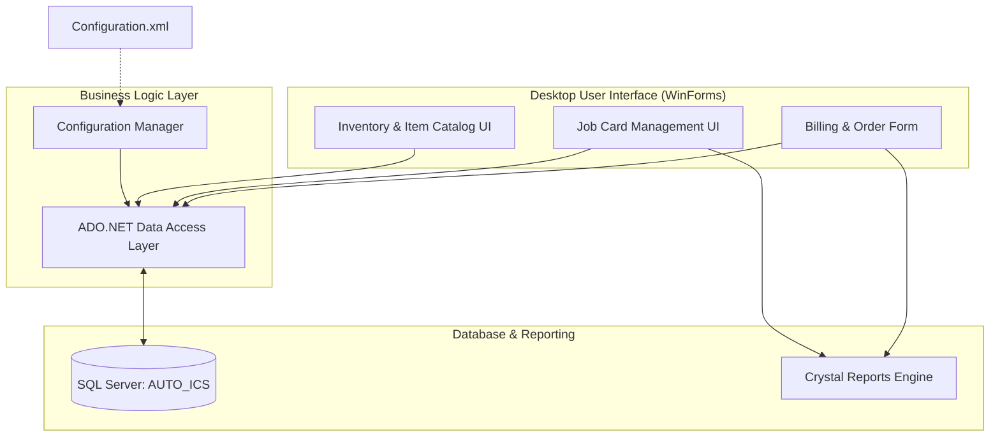

# Ruwana Enterprises — C# Desktop Billing & Inventory Management System

A C# WinForms application for order processing, billing, job-card handling, and customized Crystal Reports invoicing at Ruwana Enterprises.

## System Architecture

## Core features

- **Job card management** — create and track print jobs from intake through completion
- **Custom invoice and receipt printing** — Crystal Reports templates for A5 invoices and related documents
- **Billing and payment processing** — totals, advances, balances, and payment records
- **Item and inventory tracking** — goods received, issued, and stock-related desktop workflows
- **Desktop UI workflows** — WinForms screens for jobs, customers, suppliers, reports, and administration

## Tech stack

- C#
- .NET Framework 4.8
- Windows Forms
- Crystal Reports
- SQL Server

## Setup and installation

1. Install **Visual Studio** with the **.NET desktop development** workload.
2. Install the **Crystal Reports** runtime (32-bit). This project is built as **Debug | x86**.
3. Have a **SQL Server** instance with the application database available.
4. Clone this repository and open `Billing & Inventory Management System.sln` in Visual Studio.
5. Copy `Configuration.sample.xml` to `bin\x86\Debug\Configuration.xml` and fill in your local server, database, and credentials. That file is gitignored and must not be committed.
6. Build the **Debug | x86** configuration and run the application.

Database settings are read from local `Configuration.xml` only. No credentials are stored in source control.
